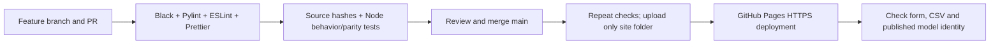

# Restaurant Review Lab

**Application:** [Open Restaurant Review Lab](https://subhashdixit.github.io/restaurant-review-classifier/)

A complete HTML/JavaScript app for **binary restaurant-review sentiment classification**, with real training, reproducible evaluation and browser-local inference. Enter a review or score a CSV; inspect the positive-label score and threshold, then export the result.

## Problem and source

The original repository contains Flask code and legacy pickle objects but not its training TSV. The maintained app uses the official **Yelp subset of UCI Sentiment Labelled Sentences**: 1,000 sentences, originally 500 positive and 500 negative. This is a disclosed source/model replacement, not an invented evaluation of the missing dataset.

Attribution: Kotzias, D. (2015). [Sentiment Labelled Sentences](https://doi.org/10.24432/C57604), UCI Machine Learning Repository, **CC BY 4.0**. The curated source intentionally selected clear positive/negative examples. It has no neutral label and does not represent all real review language. Original artifacts remain available for historical comparison.

## Use it

1. Read the synthetic starting review and classify it.
2. Change the wording and inspect the score. The app learns lexical associations; it does not reliably understand sarcasm or mixed intent.
3. Adjust the threshold to see how the binary decision changes. Published metrics still use the validation-selected threshold.
4. Download the sample CSV and retain the `review` header. Upload up to 500 rows / 2 MiB.
5. Download row numbers, predictions, scores and reliability warnings. Inputs are processed in the browser, not posted to a model API.

Reviews require **3–4,000 characters**, with a maximum of 1,000 recognized word tokens. Empty/nontext inputs fail clearly. If an input has no training-vocabulary overlap, the app shows an explicit **unreliable result** warning. A score is not a calibrated probability that a customer was satisfied, and this is not a current restaurant rating service.

## How it works

```mermaid
flowchart LR
 A[Attributed labelled Yelp sentences] --> B[Group normalized duplicates]
 B --> C[Train / validation / test]
 C --> D[Fit training-only word and bigram vocabulary]
 D --> E[Sublinear TF-IDF and L2 normalization]
 E --> F[Naive Bayes / Logistic Regression]
 F --> G[Validation ranking and threshold]
 G --> H[Held-out evaluation]
 H --> I[Export vocabulary, IDF and weights]
 I --> J[Verified JavaScript inference on GitHub Pages]
```



**Tokenization:** lowercase text, extract ASCII letter sequences of at least two characters, then add adjacent word pairs. For example, `Not good!` becomes `not`, `good`, `not good`. This explicit rule is identical in Python and JavaScript. It does not stem words or support every language. Bigram features can represent a phrase but do not guarantee correct treatment of negation.

**TF-IDF:** count a feature, use sublinear term frequency `1 + log(count)`, multiply by its training-fitted inverse document frequency, then divide the vector by its L2 norm. The vocabulary has **1154 features**, capped at 4,000 with minimum training document frequency 2. Vocabulary and IDF never fit validation/test text.

**Multinomial Naive Bayes** combines class priors and weighted feature log probabilities, assuming conditional feature independence. It is compact and useful for small text datasets, but correlated phrases violate the assumption. **Logistic regression** is the linear discriminative comparison, fitted with regularization. Both are compared using validation average precision.

Selected model: **multinomial_naive_bayes**. For binary Naive Bayes, the portable model exports `log P(feature|1) − log P(feature|0)` and the log prior ratio. Their dot product with the TF-IDF vector gives a margin; the sigmoid converts it to the same normalized binary score as sklearn. This is an exact numeric export of the selected model, not a keyword-only mock-up.

## Evaluation

Grouped normalized review text is split with seeds 42 and 43: **600 training / 200 validation / 200 test** rows. Grouping reduces exact-text leakage, but is not author/time-separated validation. Validation selects the model and an F1-oriented threshold of **0.43**; test labels select neither.

| Held-out test measure | Result |
|---|---:|
| Accuracy | 0.6850 |
| Macro F1 | 0.6827 |
| Positive precision | 0.6471 |
| Positive recall | 0.7857 |
| Positive F1 | 0.7097 |
| Average precision | 0.8271 |
| ROC AUC | 0.8126 |

Confusion matrix, rows actual and columns predicted: `[[60, 42], [21, 77]]`. These errors are substantial. A small curated test does not establish performance on a current review platform.

Accuracy counts all correct labels. Precision describes false-alarm risk among predicted positives; recall describes missed source positives. F1 balances them at a chosen threshold. Macro F1 weights both classes equally. Average precision measures positive-class ranking across thresholds and depends on prevalence; ROC AUC compares positive/negative ranking but does not describe one operating point. The full baseline/candidate reports and source/artifact SHA-256 are in [reports/metrics.json](reports/metrics.json).

## Tests and privacy

Ten Node tests check held-out Python/JavaScript score parity, exact unigram/bigram tokenization, L2 normalization, unknown-vocabulary warnings, schema/size bounds, thresholds, CSV edge cases and model identity. JavaScript arithmetic agrees with the sklearn pipeline within `1e-9` on the released held-out fixtures.

No API key, remote NLP provider, analytics script or persistent review storage is used. GitHub serves normal website assets; user-entered text stays in the browser. CSV computation uses a local worker. Literal HTML is treated as text, and spreadsheet-formula prefixes are escaped in exports. Browser extensions and a shared computer remain outside the app's control.

## Run locally

Use Node.js **22+** for JavaScript development/checks and Python **3.10 or 3.11** for training and the simple local web server.

```bash
git clone https://github.com/subhashdixit/restaurant-review-classifier.git
cd restaurant-review-classifier
npm ci
npm test
npm run lint
npm run format
python3 -m http.server 8000 --directory site
```

Open `http://127.0.0.1:8000`. Serve over HTTP rather than opening `index.html` with `file://`, because model fetching, modules and workers need an appropriate origin. Production uses HTTPS on Pages. No API key, Docker container or backend account is needed to use this browser app.

## Reproduce training

```bash
python3 -m venv .venv
source .venv/bin/activate
python -m pip install -r requirements-training.txt
python scripts/train.py
python scripts/check_release.py
python -m black --check scripts
python -m pylint scripts
npm test
```

On Windows, activate `.venv\Scripts\activate` instead. Training reads the included source file, reconstructs the split and writes `site/model.json`, `site/sample.json`, `site/metrics.json` and `reports/`. Source data is not fetched live by an end user. Review source rights, model results and hash changes before committing a retrained release.

Legacy count-vectorizer and random-forest pickle files are preserved but are not used by the new site. This release is a separately measured UCI Yelp model.

## Project structure

```text
site/index.html          accessible HTML interface
site/style.css           responsive local styling
site/app.js              form, results, plots and batch orchestration
site/text-engine.js      TF-IDF, binary scoring and text validation
site/model-engine.js     shared safe CSV helpers
site/model-worker.js     bounded local batch work
site/model.json          frozen numeric model; no executable pickle
site/metrics.json        evaluation and source/artifact hashes
site/project.json        purpose, limitations and view configuration
scripts/train.py         reproducible project-specific source adapter/training
scripts/check_release.py source/model identity checks
tests/model.test.js      real-model parity, validation, CSV and metadata checks
reports/                 full metrics and held-out parity fixtures
docs/text-contract.md    tokenization, review schema and limits
archive/                 preserved previous documentation
.github/workflows/       test and GitHub Pages release pipeline
```

## CI/CD and GitHub Pages



**CI** repeats code and behavior checks for changes, including a real Python/JavaScript model comparison. It catches regressions and packaging mistakes; it does not certify the statistical validity of the dataset. **CD** publishes the checked static artifact from `main`. PRs run checks without publishing. Actions are pinned to reviewed commit hashes, and only the deployment job gets Pages publishing permissions.

Enable **Settings → Pages → Source → GitHub Actions**. The workflow `.github/workflows/pages.yml` builds/tests and uploads `site/`; it does not publish legacy datasets, Python environments or reports as website assets. The repository About/README link points to the verified live app after rollout.

**Hosting** supplies the public asset server; **deployment** replaces its files with a particular revision. GitHub Pages needs no server process, paid inference quota or container here. Docker can be useful for a Python training environment, but is unnecessary for serving these static browser files.

**Versioning:** Git records code, configuration, model weights and evaluation together. Tag known-good releases. Update preprocessing and the exported model as one reviewed change. The model's schema version and report hashes identify the inference contract.

**Rollback:** revert a faulty change through a PR and let the same workflow publish the previous compatible artifacts. Restore model, schema and metrics together, then repeat a synthetic form/CSV check. Deleting a review branch does not delete its merged changes. Main is the maintained branch, with merged branches removed automatically.

**Retraining versus redeployment:** retraining changes learned parameters and needs a new evaluation review; redeploying unchanged files does not create a new model. Useful future work includes time-separated validation, subgroup/coverage analysis, better source documentation and calibrated uncertainty. Those are not claimed as completed.

References: [GitHub Pages](https://docs.github.com/en/pages/getting-started-with-github-pages/what-is-github-pages), [scikit-learn evaluation](https://scikit-learn.org/stable/modules/model_evaluation.html), [common leakage pitfalls](https://scikit-learn.org/stable/common_pitfalls.html).
